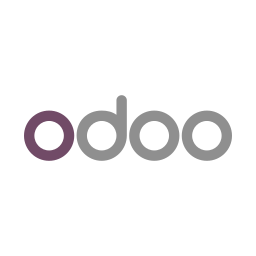
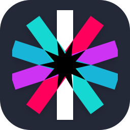
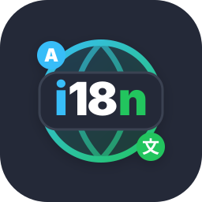
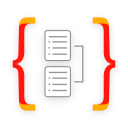
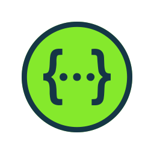
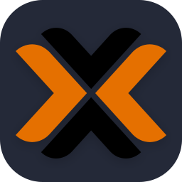
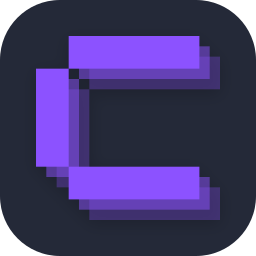
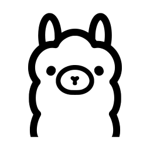

<!-- markdownlint-disable MD041 -->

## 👋 ¿Quién soy?

Soy **David Torró**, desarrollador de software centrado en crear proyectos reales, útiles y bien estructurados.

Me gusta construir cosas que no se queden solo en la teoría: aplicaciones web, APIs, bots, automatizaciones, servicios propios e infraestructura.

Aprendo haciendo, pero intentando hacerlo con cabeza: código limpio, arquitectura clara y proyectos que pueda mantener y evolucionar con facilidad.

Mi enfoque está bastante claro: **crear software que funcione, se entienda y pueda crecer**.

---

## 🚀 En qué estoy enfocado ahora

- 🧩 **Desarrollo web y full-stack**
- ⚙️ **Backends y APIs robustas**
- 🤖 **Bots, automatización y herramientas propias**
- 🧠 **IA local aplicada a proyectos para experimentar**
- 🛰️ **Homelab para servicios propios, despliegues e infraestructura**
- 🧼 **Código limpio, ordenado, mantenible y sobre todo escalable**

---

## 🛠️ Stack y herramientas

<!-- markdownlint-disable MD033 MD045 MD009 -->

  
<strong>Lenguajes de Programación</strong>

  
        

  
<strong>Desarrollo Backend</strong>

  
      

  
<strong>Desarrollo Frontend</strong>

  
    

  
<strong>Desarrollo Móvil/Multiplataforma</strong>

  
 

  
<strong>Bases de Datos y ORMs</strong>

  
     

  
<strong>Testing</strong>

  
 

  
<strong>Documentación</strong>

  
   

  
<strong>Infraestructura y DevOps</strong>

  
        

  
<strong>Nube</strong>

  
 

  
<strong>Herramientas</strong>

  
    

  
<strong>Sistemas</strong>

  
    

---

## 🖥️ Algunos de mis proyectos

<table>
  <tr>
    <td width="50%" valign="top">

### 📝 Note Nav Cards

Plugin para Obsidian que permite crear tarjetas de navegación entre notas mediante bloques de código simples y configurables.

  
  

<a href="https://github.com/DavidTorro/Obsidian-Note-Nav-Cards-Plugin">
  <strong>Ver proyecto →</strong>
</a>

   
  </td>
  <td width="50%" valign="top">

### 📄 README Generator

Herramienta de línea de comandos para crear archivos `README.md` profesionales de forma guiada, rápida y personalizable.

  
  
  

<a href="https://github.com/DavidTorro/README-GENERATOR">
  <strong>Ver proyecto →</strong>
</a>
   
  </td>
  </tr>

  <tr>
    <td width="50%" valign="top">

### 🌐 LinkedFlow

Plataforma enfocada en la automatización, generación de contenido y gestión de interacciones para LinkedIn.

  
  
  
  

<a href="https://github.com/DavidTorro/LINKEDFLOW">
  <strong>Ver proyecto →</strong>
</a>

  </td>
  <td width="50%" valign="top">

### 🛰️ Homelab personal

Infraestructura propia para desplegar servicios, bases de datos, aplicaciones, automatizaciones y entornos de desarrollo reales.

  
  
  
  
  
  
  

  </td>
  </tr>
</table>

---

## 🤔 Mentalidad

Estoy en una etapa de aprendizaje constante, pero con una idea muy clara: quiero aprender construyendo cosas reales.

No busco llenar GitHub de repos vacíos ni hacer proyectos sin fondo. Prefiero crear herramientas, romper cosas, arreglarlas, entenderlas y mejorar la siguiente versión.

---

## 📬 Contacto

Puedes contactarme a través de correo electrónico, LinkedIn o Instagram. 

Siempre estoy abierto a nuevas oportunidades, colaboraciones y proyectos interesantes.

<!-- markdownlint-disable MD033 MD045 MD047 MD009 -->

 

  
  &nbsp;&nbsp;&nbsp;&nbsp;&nbsp;&nbsp;&nbsp;&nbsp;&nbsp;&nbsp;&nbsp;&nbsp;&nbsp;&nbsp;&nbsp;
  
  &nbsp;&nbsp;&nbsp;&nbsp;&nbsp;&nbsp;&nbsp;&nbsp;&nbsp;&nbsp;&nbsp;&nbsp;&nbsp;&nbsp;&nbsp;
  

